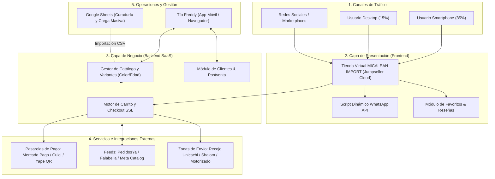

# INFORME TÉCNICO Y PLAN DE IMPLEMENTACIÓN INTEGRAL
## Proyecto: E-Commerce MICALEAN IMPORT
**Cliente:** Freddy (MICALEAN IMPORT - Mercado Unicachi, Lima, Perú)  
**Equipo Responsable:** Startup de Desarrollo e Integración Web  
**Fecha de Emisión:** Octubre 2026  
**Versión:** 1.0 (Documento Maestro de Ingeniería y Operaciones)

---

## 1. INTRODUCCIÓN Y CONTEXTO DEL NEGOCIO

### 1.1. De la Galería Comercial a la Omnicanalidad
El cliente opera físicamente en el **Mercado Unicachi** (Lima Norte, Perú), un centro neurálgico de comercio de alta rotación. Su rubro principal es la comercialización minorista y distribución de **juguetes didácticos y artefactos de estimulación/cuidado para bebés** (andadores, cunas, coches, extractores, esterilizadores, etc.).

El objetivo no es únicamente tener una página web informativa, sino crear una **plataforma de comercio electrónico automatizada y transaccional**, capaz de:
1. Captar clientes que buscan productos para bebés por internet en Lima Metropolitana y provincias.
2. Servir como catálogo digital interactivo para cerrar ventas asistidas por WhatsApp.
3. Sincronizar stock con marketplaces como **PedidosYa** y **Falabella Seller Center**.
4. Facilitar la rotación bimestral de inventario (ingreso de nueva mercadería cada dos meses).

---

## 2. ARQUITECTURA DE LA SOLUCIÓN

Para un profesional junior o un equipo que realiza su primera implementación comercial, es fundamental entender **cómo fluye la información y cómo interactúan las piezas**.



### 2.1. Desglose de las 4 Capas del Sistema

1. **Capa de Entrada (Tráfico y Experiencia de Usuario):**
   * El 85% de las visitas provendrán de teléfonos móviles conectados a redes 4G/5G.
   * La interfaz debe responder en menos de 2.5 segundos, con botones amplios diseñados para el pulgar y tipografía limpia.
2. **Capa de Presentación y Frontend (Jumpseller Storefront):**
   * Construida sobre el motor de plantillas de Jumpseller (Liquid + HTML5 + CSS3 + JavaScript).
   * Incorpora personalizaciones de código propietario de la startup: botón de compra asistida por WhatsApp y badges de confianza local (*"Punto de entrega en Unicachi"*).
3. **Capa de Negocio y Persistencia (Jumpseller Cloud Engine):**
   * Gestiona la base de datos de productos, control de stock por color/modelo, carritos de compra y procesamiento de órdenes sin necesidad de administrar un servidor Linux ni bases de datos SQL a mano.
4. **Capa de Integraciones (Pasarelas, Envíos y Marketplaces):**
   * Conecta los servicios bancarios peruanos (Niubiz/Culqi/Mercado Pago/Yape) y las reglas logísticas para envíos en Lima y provincias.

---

## 3. ESPECIFICACIÓN DETALLADA DE REQUERIMIENTOS

### 3.1. Requerimientos Funcionales (RF)

| Código | Requerimiento | Descripción Técnica y Alcance |
| :--- | :--- | :--- |
| **RF-01** | **Catálogo y Categorización** | Clasificación por categorías de bebés (Andadores, Coches, Estimulación temprana, Accesorios). Soporte para filtros por rango de edad, precio y temporada. |
| **RF-02** | **Ficha de Producto Especializada** | Exhibición detallada de especificaciones reales: funciones, accesorios (música, tipo de freno), niveles de altura ajustables, material y recomendaciones de edad. |
| **RF-03** | **Gestión de Variantes por Temporada** | Selector de colores (Negro, Verde, Rosado, Celeste, etc.) con cambio dinámico de fotografía y control de stock independiente por variante. |
| **RF-04** | **Lista de Favoritos (Wishlist)** | Funcionalidad nativa del Plan Plus que permite a padres y familiares guardar productos para compras futuras o listas de regalos de cumpleaños/bautizo. |
| **RF-05** | **Sistema de Reseñas y Calificaciones** | Módulo de puntuación de 1 a 5 estrellas con comentarios validados para construir prueba social (*Social Proof*) y confianza. |
| **RF-06** | **Botón Dinámico de WhatsApp** | Inyección de script frontend para abrir un chat directo con Tío Freddy enviando automáticamente: nombre de producto, SKU, variante elegida, precio y enlace web. |
| **RF-07** | **Checkout Flexible Multicanal** | Posibilidad de finalizar la compra online (tarjeta/Yape) o seleccionar *"Coordinar pedido por WhatsApp / Pago contraentrega"*. |
| **RF-08** | **Carga Masiva Bimestral (CSV/Sheets)** | Módulo de importación y exportación masiva capaz de procesar hasta 500 productos y variantes en un solo lote mediante archivo delimitado por comas. |
| **RF-09** | **Carga Masiva de Multimedia (ZIP)** | Capacidad de alojar y asociar imágenes de productos mediante carga en lote al servidor de medios (CDN). |
| **RF-10** | **CRM y Gestión de Postventa** | Base de datos de clientes integrada para consulta de historial de compras, estados de despacho (*Pendiente, Pagado, En Ruta, Entregado*) y envío de garantías/instrucciones. |

### 3.2. Requerimientos No Funcionales (RNF)

| Código | Requerimiento | Métrica / Estándar de Cumplimiento |
| :--- | :--- | :--- |
| **RNF-01** | **Mobile-First Responsiveness** | Diseño adaptable con 100% de usabilidad en pantallas desde 360px de ancho. Cumplimiento de Core Web Vitals en Google PageSpeed. |
| **RNF-02** | **Velocidad de Carga** | Tiempo de interacción inicial (*First Contentful Paint*) menor a 2.0 segundos en conexiones móviles 4G. |
| **RNF-03** | **Disponibilidad y Confiabilidad** | Nivel de servicio (SLA) del 99.9% garantizado por la infraestructura cloud de Jumpseller. Cero caídas por falta de mantenimiento en VPS. |
| **RNF-04** | **Seguridad Transaccional** | Navegación bajo HTTPS con certificado SSL TLS 1.3. Cumplimiento de estándar PCI-DSS nivel 1 delegado en las pasarelas oficiales de pago. |
| **RNF-05** | **Optimización de Activos (Imágenes)** | Imágenes de catálogo comprimidas en formatos WebP/JPEG optimizado con un peso máximo de 180 KB por foto. |
| **RNF-06** | **Facilidad de Uso Administrativo** | Curva de aprendizaje menor a 1 hora para el operador final (Tío Freddy) para actualizar stock y procesar órdenes desde su smartphone. |

---

## 4. PIPELINE DE DATOS Y CURADURÍA DEL CATÁLOGO (ETL)

El gran desafío técnico y operativo en este proyecto no es solo la plataforma web, sino el **procesamiento y transformación de los datos que vienen del mayorista**.

### 4.1. El Problema de Origen
1. Las fotos provienen de WhatsApp y catálogos de distribuidores de importación.
2. Contienen leyendas no aptas para el cliente final (ejemplo: *"Caja de 4 unidades"*, *"Precio x bulto S/ 85"*).
3. Si estos textos o precios de fábrica se publican, destruyen el margen de ganancia del negocio y confunden al comprador.

### 4.2. Flujo de Transformación de Datos

```
[Fotos WhatsApp + Audios] 
       │
       ▼
[Paso 1: Limpieza Gráfica] ──► Recorte y borrado de marcas de agua / textos de mayorista
       │
       ▼
[Paso 2: Staging en Google Sheets] ──► Ficha limpia, especificaciones, precio minorista
       │
       ▼
[Paso 3: Exportación a CSV] ──► Formato oficial Jumpseller (30 columnas)
       │
       ▼
[Paso 4: Ingesta Masiva] ──► Catálogo publicado en la tienda virtual en segundos
```

### 4.3. Diccionario de Datos del Archivo CSV (Plantilla Jumpseller)

El archivo maestro `plantilla_productos.csv` ubicado en el proyecto contiene los siguientes campos clave estructurados:

1. `Permalink`: Identificador único URL amigable (ej: `andador-musical-bebe-ergonomico`).
2. `Nombre`: Nombre comercial limpio (ej: *Andador Musical Ergonómico 3 Alturas con Freno*).
3. `Descripción`: Código HTML o texto plano con las viñetas de características (sin leyendas de mayorista).
4. `Categoría`: Rama taxonómica (ej: *Bebés > Andadores y Caminadores*).
5. `Precio`: Precio minorista en soles peruanos (ej: `149.00`).
6. `Precio de descuento`: Precio tachado de promoción (ej: `179.00` para mostrar oferta).
7. `Stock`: Unidades físicas disponibles para la venta virtual.
8. `SKU`: Código de inventario interno (ej: `MCL-AND-01-AZ`).
9. `Variante 1 Nombre de Opción`: `Color`.
10. `Variante 1 Tipo de Opción`: `option`.
11. `Variante 1 Valor de Opción (Color)`: `Azul`, `Rosado`, `Verde menta`.
12. `Variant 1 Option Custom`: Código Hexadecimal para mostrar la bolita de color en la web (ej: `#1E90FF`).
13. `Images`: URL pública de la fotografía o nombre del archivo cargado.

---

## 5. ESPECIFICACIÓN DE PASARELAS Y LOGÍSTICA PARA PERÚ

### 5.1. Ecosistema de Pagos

Para el mercado de Lima y Unicachi se deben habilitar tres niveles de pago:

```
                      MÉTODOS DE PAGO
                             │
     ┌───────────────────────┼────────────────────────┐
     ▼                       ▼                        ▼
[Tarjetas Online]       [Billeteras QR]         [Pago Manual / Offline]
- Mercado Pago Perú     - Yape (Número y QR)    - Transferencia BCP/BBVA
- Culqi / Niubiz        - Plin (Número y QR)    - Pago contraentrega Lima
```

1. **Pasarela de Tarjetas (Mercado Pago Perú):**
   * Permite cobro con Visa, Mastercard, Diners, American Express y tarjeta Oh!/Saga.
   * Acreditación inmediata y protección contra fraudes.
2. **Billeteras Digitales (Yape y Plin):**
   * Se configura como método manual asistido en Jumpseller:
     * El checkout muestra el código QR de MICALEAN IMPORT y el número telefónico de Freddy.
     * El cliente realiza el pago y adjunta su número de operación o captura de voucher.
3. **Contraentrega en Efectivo / Yape al Recibir:**
   * Habilitado exclusivamente para Lima Metropolitana previa validación telefónica/WhatsApp.

### 5.2. Ecosistema de Despacho y Logística

1. **Recojo en Tienda (Costo: S/ 0.00):**
   * Ubicación física: *Mercado Unicachi, Módulo de MICALEAN IMPORT, Comas / Lima Norte*.
   * Fomenta la confianza de clientes de distritos aledaños (Comas, Los Olivos, Carabayllo, Independencia, San Martín de Porres).
2. **Envío por Zonas en Lima Metropolitana (Motorizado / Courier Express):**
   * **Zona 1 (Lima Norte):** S/ 10.00 (Entrega en 24h).
   * **Zona 2 (Lima Centro y Moderna - San Isidro, Miraflores, Surco):** S/ 15.00.
   * **Zona 3 (Lima Sur y Este - Chorrillos, VMT, SJL, Ate):** S/ 18.00 a S/ 20.00.
3. **Envíos a Provincias (Agencias de Carga):**
   * Envío mediante **Shalom Empresarial**, **Marvisur** u **Olva Courier**.
   * Modalidad: Pago de flete contraentrega en la agencia de destino. Costo del embalaje y traslado a agencia en Lima: S/ 10.00.

---

## 6. INTEGRACIÓN CON MARKETPLACES (OMNICANALIDAD)

Una de las grandes solicitudes de Tío Freddy fue vender en **PedidosYa**, **Falabella** y **Mercado Libre**:

1. **Integración con PedidosYa:**
   * A través de la API/conector de Jumpseller con PedidosYa Envíos y Tiendas de Conveniencia.
   * Permite despachar artículos de bebé de urgencia (biberones, extractores, juguetes para regalo) con entrega en menos de 60 minutos en el radio de Unicachi.
2. **Integración con Falabella Seller Center:**
   * Sincronización mediante feed de catálogo de productos (formato XML/CSV).
   * MICALEAN IMPORT aparece como vendedor oficial dentro del marketplace de Falabella.com.
3. **Integración con Redes Sociales (Meta Commerce):**
   * Generación de Pixel de Meta y catálogo sincronizado con Instagram Shopping y Facebook Marketplace.

---

## 7. CRONOGRAMA DE DESARROLLO Y FASES DE TRABAJO

Para ejecutar el proyecto con éxito entre los dos compañeros de la startup, el plan de trabajo se organiza en **6 etapas secuenciales**:

```
[Semana 1: Datos & Diseño] ──► [Semana 2: Carga & Código] ──► [Semana 3: Pruebas & Go-Live]
```

### Etapa 1: Curaduría y Modelado de Datos (Días 1 al 3)
* Descarga de imágenes de la carpeta `productos/`.
* Procesamiento gráfico: borrado de "caja de cuatro" y logos de mayoristas.
* Llenado del Google Sheets con los datos técnicos (especificaciones, colores, stock estimado).
* Validación de precios minoristas con Tío Freddy.

### Etapa 2: Identidad Visual y Prototipo (Días 4 al 5)
* Creación de logotipo minimalista para *MICALEAN IMPORT*.
* Paleta de colores cálida (tonos pastel acordes al cuidado infantil: azul cielo, beige suave, verde menta).
* Diseño de 2 banners de cabecera:
  * Banner 1: *"Andadores y Juguetes de Estimulación Infantil - Calidad y Seguridad"*.
  * Banner 2: *"Envíos a todo el Perú por Shalom / Recojo en Galería Unicachi"*.

### Etapa 3: Activación de Jumpseller y Carga Masiva (Día 6)
* Creación de la cuenta en Jumpseller bajo el correo oficial `micaleanimport@gmail.com`.
* Activación del periodo de prueba gratuita de 7 días (habiendo preparado todo el contenido antes para no desperdiciar días).
* Carga masiva del archivo `plantilla_productos.csv` con todas las variantes.

### Etapa 4: Customización Frontend e Integraciones (Días 7 al 9)
* Selección de plantilla base ultra-responsive en Jumpseller.
* Inyección de código JavaScript para el **Botón Dinámico de WhatsApp** en la ficha del producto:
```javascript
// Ejemplo conceptual del script a inyectar en la plantilla de producto
function pedirPorWhatsApp(nombreProducto, variante, precio) {
    const telefono = "519XXXXXXXX"; // Número del Tío Freddy
    const mensaje = `Hola MICALEAN IMPORT, estoy interesado en comprar el producto: ${nombreProducto} (Variante: ${variante}) al precio de S/ ${precio}. ¿Tienen stock disponible para entrega?`;
    const url = `https://wa.me/${telefono}?text=${encodeURIComponent(mensaje)}`;
    window.open(url, '_blank');
}
```
* Configuración de métodos de pago (Mercado Pago, Yape, transferencias).
* Configuración de reglas de despacho por distritos y provincias.

### Etapa 5: Conexión de Dominio y Testing Integral (QA) (Días 10 al 11)
* Adquisición y vinculación del dominio personalizado (ej. `micaleanimport.com`).
* Configuración de registros DNS (A, CNAME).
* **Prueba Transaccional End-to-End:** Realizar una compra real de S/ 1.00 desde un celular para verificar:
  1. Que el stock se descuente.
  2. Que llegue el correo de confirmación al cliente y a `micaleanimport@gmail.com`.
  3. Que el pedido figure en el panel del administrador.

### Etapa 6: Capacitación y Entrega Oficial (Días 12 al 14)
* Sesión presencial o por videollamada de 30 minutos con Tío Freddy.
* Entrega de la guía rápida de gestión de pedidos en teléfono móvil.
* Publicación oficial en redes y puesta en marcha comercial.

---

## 8. PLAN DE CAPACITACIÓN Y OPERACIÓN DIARIA PARA EL CLIENTE

Para que el Tío Freddy sea completamente autónomo en su día a día desde el puesto de Unicachi, se le capacitará en tres tareas rutinarias:

### 8.1. Gestión de Pedidos Nuevos (3 pasos en el Celular)
1. Al recibir la notificación de venta por correo o WhatsApp, ingresar al panel móvil de Jumpseller.
2. Comprobar el estado del pago:
   * Si pagó por Mercado Pago: figura como *"Pagado"* automáticamente.
   * Si pagó con Yape: verificar en el app de Yape la recepción del dinero y marcar *"Pago Recibido"*.
3. Cambiar el estado del pedido a *"En Preparación / Despachado"* y entregar el paquete al courier o tenerlo listo para recojo en Unicachi.

### 8.2. Control de Stock Rápido
* Si en el puesto físico de Unicachi se agotan los andadores color verde, ingresar a *Productos > Variantes* y colocar el stock en `0`. La página mostrará de inmediato *"Agotado"* en ese color para no vender lo que no tiene en mano.

### 8.3. El Ciclo Bimestral de Renovación de Catálogo
* Cada dos meses, cuando lleguen los nuevos contenedores con juguetes de temporada:
  1. Freddy toma fotos individuales de los nuevos modelos.
  2. Envía la lista de precios a la startup.
  3. La startup actualiza el Google Sheets maestro y ejecuta una nueva importación masiva en 15 minutos.

---

## 9. MODELO DE NEGOCIO PARA LA STARTUP

Para asegurar la rentabilidad del trabajo de tu compañera y tuyo, la estructura de cobro recomendada para este tipo de clientes es:

1. **Costo de Implementación Inicial (Setup y Desarrollo):**
   * Comprende: curaduría de datos, limpieza de fotos, configuración de Jumpseller, desarrollo de scripts de WhatsApp, pasarelas de pago, configuración de dominio y capacitación.
   * *Monto sugerido en el mercado local:* Entre **S/ 1,200 y S/ 2,000**, dependiendo del alcance pactado.
2. **Fee Mensual de Mantenimiento y Acompañamiento (SLA):**
   * Comprende: soporte técnico, actualización bimestral del catálogo (subida de nuevos productos), ajuste de banners por campañas (Día del Niño, Navidad, Cyber Days).
   * *Monto sugerido mensual:* Entre **S/ 150 y S/ 250 / mes**. Esto asegura un ingreso recurrente para su empresa.

---

## 10. CONCLUSIONES Y PRÓXIMOS PASOS

1. **La estrategia está validada:** Jumpseller Plan Plus es la elección técnica correcta porque minimiza los costos de infraestructura, ahorra semanas de programación innecesaria de backends y resuelve la exigencia de reseñas, listas de deseos y conexión con Falabella / PedidosYa.
2. **El entregable inmediato:** Completar el llenado de las primeras filas de datos en el Google Sheets a partir de las imágenes de la carpeta `productos/` para proceder con la carga inicial.
